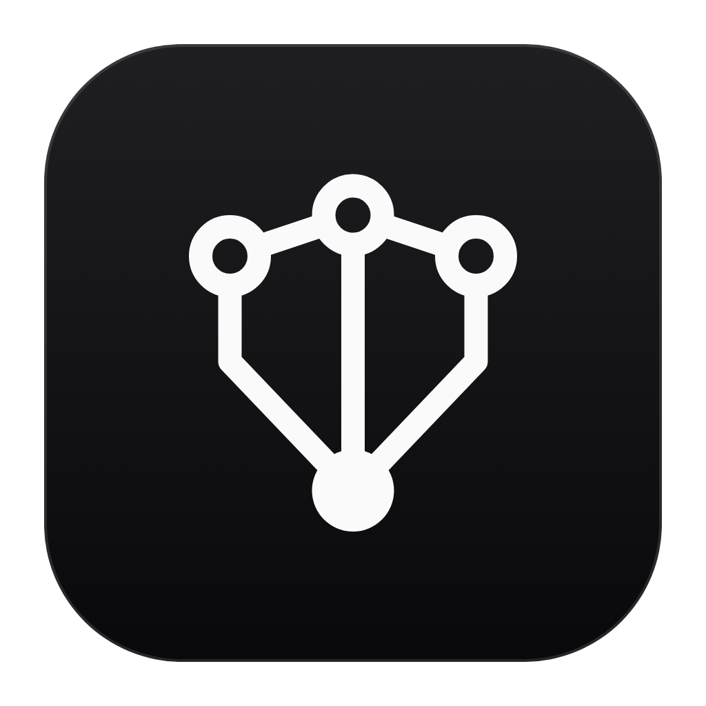
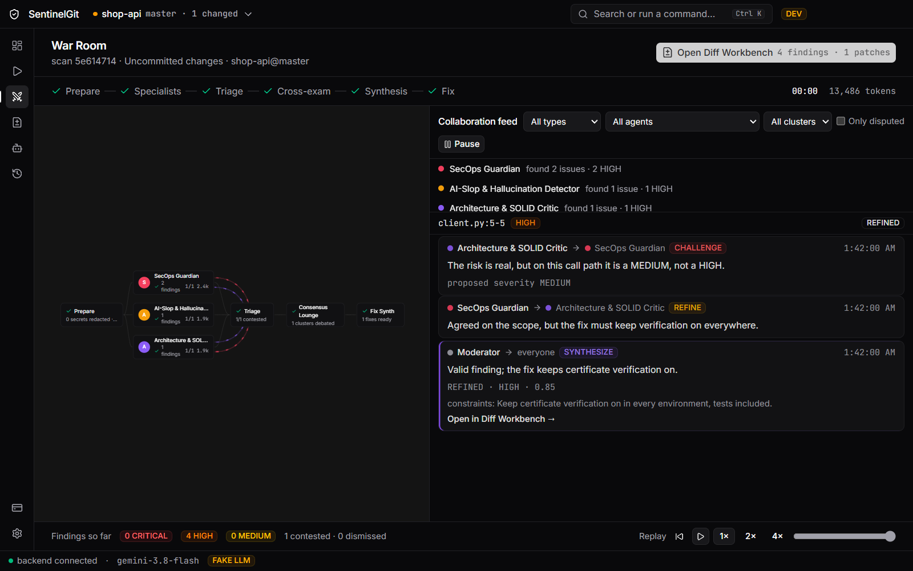
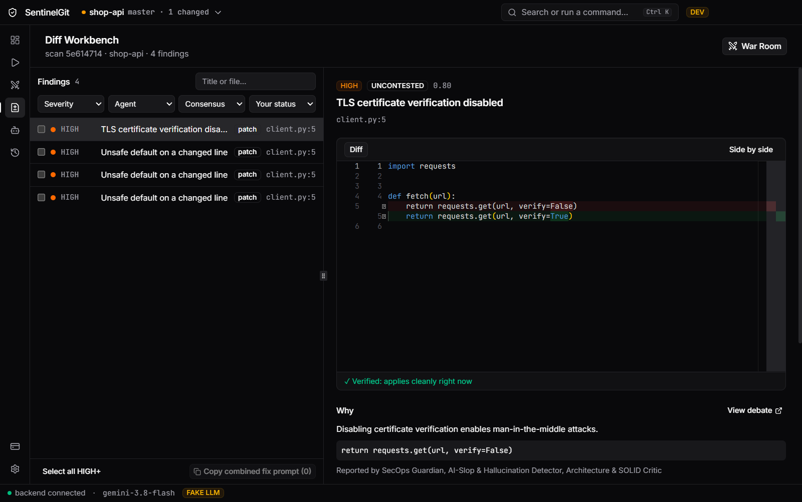

# SentinelGit AI

**A team of AI reviewers for your Git changes, running on your own machine.**

SentinelGit reviews every change for security holes, AI-generated slop and architecture problems.
When its agents disagree, they debate it openly, then hand you one agreed fix prompt and a
verified patch.

`Windows` · `macOS` · `Linux` · Public beta 0.9

## Why SentinelGit

- **Three specialists, one review.** SecOps Guardian, AI Slop Detector and Architecture Critic
  read the same diff in parallel. Add your own reviewers for the rules your team cares about.
- **Debate, not noise.** When reviewers overlap or disagree, the finding goes to the War Room,
  where they challenge each other and a moderator records the verdict. Findings nobody disputes
  skip the debate.
- **Fixes you can trust.** Every finding comes with a targeted prompt for your coding assistant
  and, where possible, a patch that has been checked against your files. Nothing changes on disk
  until you press Apply.
- **Rules in plain words.** Type "never log request bodies" and SentinelGit proposes the right
  kind of rule for it. You decide what is saved.
- **Reviews as you work.** Repositories stay live as you edit, and *Auto-scan commits* can review
  each new commit the moment you make it.

## Private by design

- **Your key, your provider.** Reviews run on your own API key for Google Gemini, Groq, OpenAI
  or Anthropic. The key is stored in your operating system's keychain.
- **Secrets stay local.** Anything in a diff that looks like a key, token or password is masked
  before a prompt is built, and reported to you as a finding.
- **No tracking.** No account, no analytics, no crash reports. The only network traffic is the
  review itself, sent to the provider you chose, and update checks, which stay off until you turn
  them on.

## Install

Download the installer for your system from the
[Releases page](https://github.com/areefurrahman/sentinelgit-releases/releases).

| System | File |
|---|---|
| Windows 10 or 11 (64-bit) | `SentinelGit-Setup-<version>.exe` |
| macOS on Apple silicon | `SentinelGit-<version>-arm64.dmg` |
| Linux (64-bit) | `SentinelGit-<version>-x86_64.AppImage` or `.deb` |

You also need [Git](https://git-scm.com/downloads) installed, an API key from one of the
supported providers (Google Gemini has a free tier), and about 500 MB of disk space. Everything
else is included.

**First launch of the beta.** The installers are not code-signed yet, so your system asks before
opening them:

- **Windows:** on the SmartScreen prompt, choose **More info → Run anyway**.
- **macOS:** open the app once, then go to **System Settings → Privacy & Security** and choose
  **Open Anyway**.
- **Linux:** make the AppImage executable (`chmod +x`) and run it, or install the `.deb`.

## Get started

1. **Add a repository:** any folder inside a Git working tree.
2. **Add your key:** Settings → AI providers. Paste it and press *Test*.
3. **Run an audit:** New Scan reviews your uncommitted changes, a range of commits, or files you
   pick.
4. **Review and fix:** follow the debate in the War Room, then copy the fix prompt or apply the
   patch from the Diff Workbench.

A short tour runs on first launch. The [user guide](docs/user-guide.md) covers every screen,
setting and shortcut.

## Plans

SentinelGit starts on the **Free** plan, which covers a personal project end to end. **Pro** and
**Team** raise the limits on repositories, custom agents, rules and debate depth. To upgrade,
activate your license key under **Account & License**; keys are verified offline.

## Help

- [User guide](docs/user-guide.md), including troubleshooting
- [What's new](CHANGELOG.md), also shown inside the app
- Found a problem? [Open an issue](https://github.com/areefurrahman/sentinelgit-releases/issues)
  with your app version (Settings → About). Logs never contain your keys.

---

© 2026 Areef ur Rahman. All rights reserved. SentinelGit AI is in public beta; features and
plans may change before 1.0.
