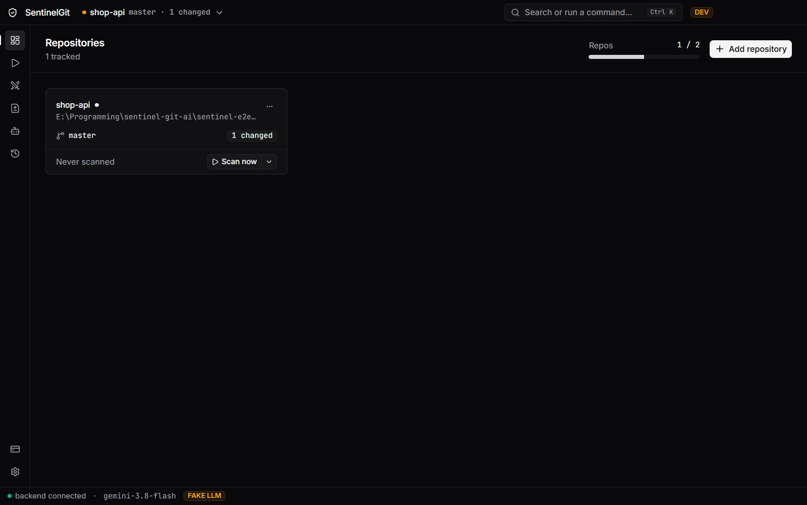

# SentinelGit AI user guide

This guide walks through every screen of the desktop app. For what SentinelGit is and how to
install it, start with the [README](../README.md). Release notes are in the
[changelog](../CHANGELOG.md) and in the app under *What's new*.

- [Getting started](#getting-started)
- [Repositories](#repositories)
- [New Scan](#new-scan)
- [War Room](#war-room)
- [Diff Workbench](#diff-workbench)
- [Agent Studio](#agent-studio)
- [Scan History](#scan-history)
- [Account & License](#account--license)
- [Settings](#settings)
- [Keyboard shortcuts](#keyboard-shortcuts)
- [Privacy and your data](#privacy-and-your-data)
- [Troubleshooting](#troubleshooting)

## Getting started

On first launch, a three-step tour explains the flow: add a repository, set your model key, then
scan, debate and fix. *Skip tour* closes it for good; reopen it any time with Ctrl/⌘+K → *Show
the tour*. After an update, *What's new* opens once with the release notes; it is also in
Settings → About.

The status bar at the bottom shows whether the backend is connected and which model new scans use.
If the backend stops, a banner appears and the app restarts it on its own.

## Repositories

The home screen. Each card is one tracked repository with its branch, how far it is ahead or
behind, the number of changed files, and the result of its last scan (open findings by
severity). Cards refresh as you work: the app polls each repo's `git status` (Settings →
Scanning → *Poll interval*) and updates when you commit, switch branches or edit files.

- **Add repository** takes a folder anywhere inside a Git working tree.
- **Scan now** starts an audit of the uncommitted changes with your default agents; the arrow next
  to it offers the other scan modes.
- **Auto-scan commits** (off by default): with it on, each new commit you make on the current
  branch is scanned by itself (that commit's diff only) as soon as the app sees it. Switching
  branches, resetting, amending, merging or pulling several commits does not start a scan, and
  neither does a commit while a scan of that repo is still running. It uses your model key's tokens.
- The **⋯** menu reveals the folder or stops tracking it (your files are never touched).

The quota meter in the header shows how many repositories your plan allows (see
[Account & License](#account--license)). The repository switcher in the title bar picks which
repo New Scan and the palette work on.

## New Scan

Choose what to review and who reviews it, then press **Run audit** (Ctrl/⌘+Enter).

| Mode | Reviews |
|---|---|
| Uncommitted changes | Your working tree against `HEAD`; optionally untracked files too |
| Commit range | `base..head`, or since the branch point (merge-base) to review a feature branch |
| Selected files | Only the files you pick, as they are now |

- **Agents**: tick the specialists for this scan. Each runs on its own model unless you set one.
- **Model**: the provider and model for this scan; the default comes from Settings → AI.
- The **estimate** shows the files, lines added, chunks, model calls and input tokens the scan
  will take, before you spend any.

*Run audit* stays disabled with a reason when something is missing: no agent selected, no
changes to review, or no key for the chosen provider (the *Add key* link goes straight to it).
Files matching your ignored paths (lock files, build output) are skipped.

## War Room

A scan runs through six steps, shown along the top: **Prepare** (secrets redacted, zero-token
STATIC rules run, the diff split into chunks), **Specialists** (agents review in parallel),
**Triage** (findings grouped into clusters), **Cross-exam** (agents challenge each other on
contested clusters), **Synthesis** (a moderator records the verdict) and **Fix** (fix prompts and
patches). Steps with nothing to do are marked skipped.

- The **topology** on the left shows each agent's progress, findings and tokens.
- The **collaboration feed** on the right shows every finding and every debate turn: CHALLENGE,
  AGREE, REFINE, and the moderator's SYNTHESIZE with the agreed severity and constraints.
  Filter by type, agent or cluster, show only disputed clusters, or pause the feed.
- A cluster is debated only when it is contested: several agents report the same lines, they
  disagree on severity, confidence is low, or their fixes overlap. Your plan caps how many
  clusters are debated and how deep (one round, or a rebuttal round too).
- Opening a finished scan replays it, with play, pause and speed controls.

**Open Diff Workbench** (top right) takes you to the results.

## Diff Workbench

Every finding of a scan, with what to do about it.

- The **list** on the left can be filtered by severity, agent, consensus and your status, or
  searched by title or file. Dismissed and suppressed findings sit in their own groups.
- The **detail** on the right shows the finding's severity (and the original one if the debate
  changed it), its consensus status and confidence, the code, why it matters and who reported it.
- The **diff** shows the patch against the file as it is now. *✓ Verified: applies cleanly right
  now* means `git apply --check` passed a moment ago. *Stale* means the file changed since the scan;
  the raw patch stays one tab away, and the fix prompt still works.
- **AI fix prompt**: a targeted prompt for your coding assistant, with the constraints the agents
  agreed on. *Copy* puts it on the clipboard. Tick several findings and *Copy combined fix
  prompt* for one prompt that covers them all.
- **Apply patch…** asks for confirmation, then writes the patch to your working tree. Nothing is
  ever applied without this click, and nothing is committed.
- **Accept** marks a finding as handled; **Dismiss** asks why (False positive, Won't fix,
  Duplicate). *View debate* jumps to the finding's cluster in the War Room.

## Agent Studio

Agents are the reviewers; rules tell an agent what to look for.

- **Describe a check or a new specialist** in plain words, for example "flag any console.log
  left in TypeScript files". SentinelGit proposes one of: a **STATIC rule** (a regex that runs
  with zero tokens), an **LLM rule** (a criterion added to an agent's prompt), a **new agent**,
  or a question when the request is unclear. Nothing changes until you confirm.
- Open an agent to change its model, switch it on or off, and edit its rules. A STATIC rule's
  pattern can be tried on a sample line before you save it. Your own agents' name, look and
  persona are editable too.
- The three built-in agents can be configured and disabled but not deleted. Your own agents can be
  deleted. A deleted rule, or what a confirmed proposal created, can be undone for five seconds.
- The **Activity** tab lists the scans an agent took part in, with its findings and how many you
  dismissed.

## Scan History

Every scan with its date, repository, mode, agents, duration, tokens, findings and status. Open one to replay it in
the War Room, or go to its findings. **Export** saves a report as Markdown or JSON (for a
ticket, a pull request, or your own tooling).

## Account & License

Your plan and how much of each limit you use: tracked repositories, custom agents, rules per
agent, debate depth and clusters per scan. Everyone starts on the **Free** plan; a locked feature
explains what it needs and how to get it.

**Pro** and **Team** unlock with a license key: paste it under *License key* and press
*Activate*. Keys are checked offline. A key can be bound to one machine: send the **device ID**
shown here (*Copy*) to get one. *Remove license* returns to Free. An expired key keeps working for
seven days, then the app returns to the Free plan without locking any data.

## Settings

Every change saves on its own.

- **AI**: the default provider and model for new scans, and one key per provider (Google Gemini,
  Groq, OpenAI, Anthropic). Keys are write-only: paste, *Test*, done. They go to the OS keychain;
  if no keychain is available they are kept in memory for this session only, and the app says so.
  When *Test* finds your model retired, it offers *Switch to* its replacement. *LLM concurrency* limits
  parallel model calls (lower it if your provider rate-limits you).
- **Scanning**: poll interval, whether untracked files are included, the minimum severity that
  gets a fix, and ignored paths (one glob per line, for every repo).
- **Appearance**: dark, light or match the system; comfortable or compact density; reduce motion.
- **Advanced**: *Reset database*, which removes repos, scans, findings, custom agents and rules
  after you type `reset`. Keys and your files are kept. To find the database or the logs, use the
  command palette: *Open data folder* or *Open logs folder*.
- **About**: versions, *What's new*, *Check for updates* (off by default; nothing is sent until
  you turn it on; an update installs only when you press *Restart to update*), and *Open-source
  licenses* (*View* lists every third-party package inside the app with its license).

## Keyboard shortcuts

Press `?` for the full list in the app. Mod is Ctrl on Windows and Linux, ⌘ on macOS.

| Keys | Action |
|---|---|
| Mod+K | Command palette: go anywhere, start a scan, switch repo, toggle agents, theme |
| Mod+Enter | Run audit (New Scan) or rerun the last scan (anywhere else) |
| Mod+1 … Mod+6 | Repositories, New Scan, War Room, Diff Workbench, Agent Studio, Scan History |
| Mod+, | Settings |
| J / K | Next / previous finding (Diff Workbench) |
| C | Copy the fix prompt |
| A | Apply patch… |
| D | Dismiss… |
| Enter | View the debate |
| Esc | Close the open dialog |

## Privacy and your data

- **What is sent**: during a scan, the redacted diff chunks and your agents' instructions go to the
  model provider you chose, with your key. Secrets that look like keys, tokens or passwords are
  replaced before any prompt is built and are reported as findings locally.
- **What is not sent**: no analytics, crash reports, usage data or account. Update checks run only
  after you turn them on.
- **Where data lives**: one SQLite database in the data folder (command palette → *Open data
  folder*): `%APPDATA%\SentinelGit` on Windows, `~/Library/Application Support/SentinelGit` on
  macOS, `~/.local/share/sentinelgit` on Linux. Keys are in the OS keychain, never in the database
  or logs.
- **Your repositories** are read with Git. The only write is *Apply patch…*, after you confirm.

## Troubleshooting

| Symptom | What to do |
|---|---|
| Windows: "Windows protected your PC" | The beta is unsigned: *More info → Run anyway*. |
| macOS: "cannot be opened because the developer cannot be verified" | Open the app once, then System Settings → Privacy & Security → *Open Anyway*. |
| "This folder is not inside a Git repository" | Pick a folder inside a working tree (one with a `.git` above it). Git must be installed and on `PATH`. |
| *Run audit* is disabled | Its reason is shown beside it: select an agent, make a change to review, or add a key. |
| A scan fails with an authentication error | Settings → AI → *Test* the key; replace it if the provider rejects it. |
| A scan waits or fails on rate limits (429) | Free tiers allow few tokens per minute or day. The app waits up to a minute and retries; beyond that, try later, lower *LLM concurrency*, or switch provider. |
| *Test* says the model is retired | Press *Switch to* the suggested model (Settings → AI). |
| A patch shows *Stale* | The file changed since the scan. Copy the fix prompt instead, or rerun the scan. |
| A key shows **● memory** with a warning | No OS keychain was found (common on minimal Linux). Install a Secret Service provider such as GNOME Keyring, or set the provider's environment variable (for example `GOOGLE_API_KEY`). |
| The backend banner keeps reconnecting | Press *Retry*. If it persists, check the log in the logs folder (command palette → *Open logs folder*). |

Still stuck? Open an issue on [GitHub](https://github.com/areefurrahman/sentinelgit-releases/issues)
with the app version (Settings → About) and the relevant log lines. Logs never contain your keys.
